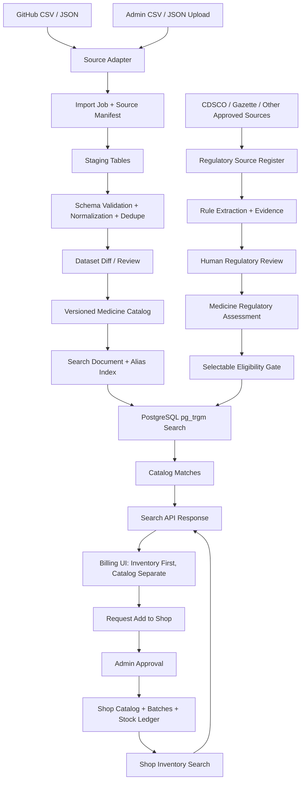

# Medicine Fuzzy Search Backend — Architecture & Implementation Plan v1.0

**Status:** Proposed design for review; not production code.  
**Chosen stack:** Python FastAPI + PostgreSQL.  
**Catalog source:** `junioralive/Indian-Medicine-Dataset` (initial source; source versions must be pinned and reviewed).

## 1. Goal

Provide fast typo-tolerant medicine search for pharmacy staff during billing while keeping these concepts separate:

1. A source medicine catalog imported from external data.
2. A shop's own catalog and stocked batches.
3. A regulatory assessment that determines whether a product can be selected.
4. The fuzzy ranking system that finds likely matches but never decides legal status or therapeutic substitutability.

The search must show shop-inventory matches first, catalog matches separately, and require authorized approval before a catalog-only medicine becomes available to a shop.

## 2. Repository audit findings

The repository README states 253,973 medicines and describes fields including `id`, `name`, `price(₹)`, `Is_discontinued`, `manufacturer_name`, `type`, `pack_size_label`, `short_composition1`, and `short_composition2`. The repository has CSV and JSON exports and is under an MIT license; retain the required copyright/license notice when redistributing portions of this dataset.

The repository also contains an `updated_indian_medicine_data.csv` alongside the README-linked CSV and JSON. Do not assume those exports are identical. Before initial import, compare file hashes, headers, row counts, IDs, field coverage, and row-level diffs; explicitly choose the initial baseline. Record repository URL, branch/commit SHA, file path, SHA-256, retrieved timestamp, raw row count, accepted row count, and importer version for each run.

`Is_discontinued = FALSE` is only a source-data flag. It is not proof of current legal marketing permission in India.

## 3. High-level architecture



### Runtime components

- **FastAPI application:** authenticated search endpoints, catalog request and review endpoints, import administration.
- **PostgreSQL:** authoritative normalized catalog, shop-specific records, import manifests, regulatory evidence/reviews, and search indexes.
- **Import worker/CLI:** downloads or accepts CSV/JSON, streams records into staging, validates, generates diffs, and prepares publication. Large imports should run in a separate worker, not occupy a request process.
- **Admin review UI (can come later):** approve imports, resolve regulatory-review queue, approve catalog-to-shop additions.
- **Scheduled source checker:** checks GitHub on a set schedule, pins a new commit/file hash, imports into staging, and waits for explicit publication approval.

## 4. Regulatory safety model

Keep source status and legal assessment in separate fields/tables.

Suggested internal states:

- `verified_allowed`: reviewed against applicable evidence and allowed for normal catalog selection under configured policy.
- `prohibited`: confirmed applicable prohibition; never selectable.
- `restricted`: restriction applies or needs condition-specific handling; not selectable by ordinary billing flow until a specific approved rule/workflow permits it.
- `unknown`: not assessed or evidence is insufficient; review queue only, not selectable.
- `under_review`: a reviewer is checking applicability; not selectable.
- `discontinued`: source reports discontinued; not selectable unless separately reconciled and explicitly overridden by a documented reviewer decision. Do not silently override the source flag.

Record, for each regulation or decision: source authority, source URL, notice/notification number, source publication/effective dates, retrieval date, rule type, exact wording or a reference to a stored document hash, applicable ingredient/formulation/product criteria, reviewer, review date, decision rationale, and superseded-by relation.

Do not create a simple rule that globally bans every product containing one ingredient merely because a fixed-dose-combination (FDC) containing that ingredient was prohibited. FDC restrictions may apply to a combination/formulation; rule matching needs ingredient-set and formulation context plus human review. Automated text matching may suggest a candidate rule but must not publish a legal decision by itself.

Initial policy: a product is selectable only if it is not discontinued and has a reviewed `verified_allowed` assessment. Confirmed `prohibited`, `restricted`, `unknown`, and `under_review` products are not selectable in standard billing autocomplete. Provide a separate admin-only regulatory review queue; do not show unverified items as ordinary selectable results.

Regulatory source set must be maintained as a versioned evidence register, starting with relevant CDSCO Section 26A notices, FDC prohibited/restricted lists, and applicable Gazette notifications. Re-check source pages on each sync; lists and notices may be added or changed. A domain expert/pharmacist/legal reviewer should approve the matching rules before production use. This system supports compliance review; it does not provide legal advice.

## 5. Proposed data model

### Dataset and catalog

1. `catalog_sources`: source name, repository URL, license attribution, update policy.
2. `catalog_import_runs`: source commit, file path, file hash, importer version, timestamps, status, counts, error report.
3. `catalog_staging_records`: raw JSON plus parsed source fields and validation status for an import run.
4. `medicines`: internal UUID, external source ID, brand/product name, normalized name, manufacturer and normalized manufacturer, type, pack-size label and normalized pack, source price, discontinued flag, source provenance, active dataset version, raw-source hash.
5. `medicine_ingredients`: medicine ID, ingredient text, normalized ingredient, strength amount/unit, source field/order. Keep parsed strength separate from the source composition text.
6. `medicine_aliases`: medicine ID, alias, normalized alias, alias type (`source_name`, `approved_spelling`, `brand_alias`, `shop_alias`), provenance, review status.
7. `catalog_versions`: published dataset version, import run, published by/at, notes.

### Regulation and review

8. `regulatory_sources`: authority, page/document URL, source type, publication/retrieval dates, content hash, current/superseded state.
9. `regulatory_rules`: rule reference/notification, scope type (`product`, `ingredient`, `ingredient_set`, `FDC`, `formulation`, `other`), rule state, effective interval, condition text, source evidence.
10. `medicine_regulatory_assessments`: medicine ID, assessment state, applied rule references, reviewed by/at, rationale, evidence snapshot, previous assessment ID.
11. `regulatory_review_tasks`: candidate match, confidence, reason, workflow status, assigned reviewer, outcome.
12. `audit_events`: append-only record for data publication, regulatory decisions, permission changes and catalog approval decisions.

### Shop inventory and approval

13. `shops`: existing Pharmacy Inventory shop record.
14. `shop_medicines`: shop ID, medicine/catalog ID or a controlled local-only product identity, local display name/alias, approval state, created/approved by, timestamps.
15. `shop_medicine_aliases`: common abbreviations/misspellings accepted by a particular shop, moderation status, creator and reviewer.
16. `batches`: shop medicine ID, batch number, expiry, MRP, pack conversion, rack, and other stock-specific fields.
17. `stock_events`: append-only stock movements with event UUID, batch, quantity delta, type, actor/device, event time, server sequence.
18. `catalog_add_requests`: shop, source medicine, requester, reason, review status, reviewer, decision.
19. `search_telemetry` (optional, privacy-minimized): normalized query, selected result ID, result position, latency, request ID; avoid storing unnecessary user/patient data.

Existing tables may already overlap with `shops`, `shop_medicines`, `batches`, and `stock_events`; integrate with the agreed Pharmacy Inventory database instead of creating duplicate systems.

## 6. Search design

### Normalize conservatively

- Unicode NFKC, lowercase, trim, collapse whitespace, normalize punctuation/hyphens, and create one canonical normalized value per searchable field.
- Normalize common unit formatting for matching (`500 mg` and `500mg`) without losing the structured strength value.
- Keep the original text for display and provenance.
- Do not erase medicine strength, dosage form, or pack size; explicit conflicting strengths/formulations should be penalized heavily or split out as distinct choices.
- Manufacturer suffix normalization may help matching, but retain the original manufacturer name.
- Use approved aliases for known spellings and local shortcuts. Do not automatically make every typo a permanent alias.

### Search sequence

1. Exact normalized medicine name.
2. Exact approved alias.
3. Prefix matches and token matches.
4. Indexed trigram fuzzy name matches.
5. Composition/manufacturer/pack-field matches and score boosts.
6. Apply the regulatory eligibility gate before any item is returned as selectable.
7. Search the shop inventory first; then return eligible catalog-only matches in a separate group.

Use PostgreSQL `pg_trgm` with `GIN` indexes for similarity and `LIKE`/`ILIKE` matching. Add ordinary B-tree indexes for exact identifiers and foreign keys. Consider `unaccent` only where needed; cross-script Hindi/English transliteration should be implemented as an explicitly tested alias/transliteration layer, not assumed to happen automatically.

Starting ranking proposal (tune using test queries):

- Exact name: 1.00 / first tier.
- Exact approved alias: 0.98 / first tier.
- Prefix/token match: 0.90–0.97 depending on match coverage.
- Fuzzy name similarity: trigram similarity plus token coverage.
- Manufacturer: up to 0.10 ranking contribution.
- Composition: up to 0.15 contribution when the query includes those terms.
- Pack/strength match: up to 0.10 boost; a conflicting explicit strength or formulation gets a strong penalty or disambiguation.

Scores are ranking aids, not probabilities of identity or legality. Evaluate thresholds against a labeled test set before production. Return a short reason such as `exact_name`, `prefix`, `typo_match`, `manufacturer_match`, or `composition_match` to help debug ranking.

## 7. API proposal

### Billing autocomplete

`GET /api/v1/shops/{shop_id}/medicine-suggestions?q={query}&limit=10`

Response shape:

```json
{
  "query": "augmentn 625",
  "catalog_version": "published-version-id",
  "inventory_matches": [
    {
      "shop_medicine_id": "...",
      "medicine_id": "...",
      "name": "Augmentin 625 Duo Tablet",
      "manufacturer": "...",
      "composition": "...",
      "pack_size": "strip of 10 tablets",
      "batch_summary": {"available_quantity": 12},
      "match_reason": "typo_match",
      "score": 0.91,
      "selectable": true
    }
  ],
  "catalog_matches": [
    {
      "medicine_id": "...",
      "name": "...",
      "manufacturer": "...",
      "composition": "...",
      "pack_size": "...",
      "match_reason": "prefix",
      "selectable": false,
      "action": "request_shop_approval"
    }
  ],
  "review_required": false
}
```

Only eligible products should appear in the normal billing result groups. Unknown/prohibited/restricted/discontinued products should not leak into ordinary results; admin reviewer APIs can show them in a separate review queue. `catalog_matches.selectable` should remain false until approved and linked to the shop.

### Other endpoints

- `POST /api/v1/admin/catalog/imports` — upload CSV/JSON; returns import job ID.
- `GET /api/v1/admin/catalog/imports/{import_id}` — progress, validation errors and counts.
- `GET /api/v1/admin/catalog/imports/{import_id}/diff` — added/changed/removed candidates.
- `POST /api/v1/admin/catalog/imports/{import_id}/publish` — publish only after permission and review checks.
- `POST /api/v1/admin/catalog/sync` — check/download a known source revision into staging.
- `GET /api/v1/admin/regulatory/review-queue` — uncertain matches for review.
- `POST /api/v1/admin/regulatory/assessments` — record a reviewed status and evidence.
- `POST /api/v1/shops/{shop_id}/catalog-add-requests` — request a catalog product be added to that shop.
- `POST /api/v1/admin/catalog-add-requests/{request_id}/approve` — approved link to shop catalog.

Use auth, role-based permissions, bounded query length/result limit, parameterized queries, request rate limits and structured logs. A cashier may search/select eligible shop items but cannot publish datasets or approve legal status/catalog changes.

## 8. Dataset ingestion and update workflow

1. Discover and pin a specific GitHub commit and file SHA; do not fetch a moving `main` file inside a live search request.
2. Download to a staging location and calculate SHA-256; record license and attribution.
3. Stream CSV rows in chunks; for JSON, use a streaming parser rather than loading the full file into memory.
4. Validate required columns, parse `id` as a string identifier, safely parse price/boolean values, normalize nulls, count malformed rows and duplicate IDs.
5. Store raw source fields in staging; never destroy source provenance during normalization.
6. Compare exports and row-level changes with currently published catalog; flag suspicious drops, mass status changes, duplicate collisions and schema drift.
7. Generate a review report; regulatory status never becomes `verified_allowed` simply because a row appears in the new dataset.
8. Publish as an atomic catalog version and refresh indexes; preserve previous version for rollback.
9. Run smoke searches and eligibility checks; if validation fails, leave the previous version active.
10. Scheduled sync checks for upstream changes (weekly is a reasonable initial default). It stages but does not automatically publish. Manual admin upload follows the same pipeline.

## 9. Project layout

```text
medicine-search-backend/
  app/
    main.py
    core/              # config, auth, permissions, logging
    db/                # session, base, models
    schemas/            # request/response Pydantic models
    api/v1/routes/      # search, catalog, imports, regulatory review
    services/           # search, normalization, eligibility, approvals
    repositories/       # database access
    importers/          # csv, json, github source adapters
    regulatory/         # source parsers, rule matching, review workflows
  worker/
    run_import.py
    run_github_sync.py
  migrations/           # Alembic
  tests/
    unit/
    integration/
    fixtures/
    search_relevance/
  scripts/
    inspect_source_exports.py
    benchmark_search.py
  docs/
    architecture.md
    regulatory-runbook.md
    data-dictionary.md
  docker-compose.yml
  pyproject.toml
  .env.example
  README.md
```

Recommended initial dependencies: FastAPI, Pydantic v2, SQLAlchemy 2, Alembic, psycopg, pytest, HTTPX, and a robust CSV/JSON import tool. Add a durable worker/queue such as Celery/RQ with Redis only when sync/import job volume or retry requirements justify it. Keep database secrets in environment/secret management; never commit `.env` credentials.

## 10. Implementation phases

### Phase 0 — Source audit and search evaluation set

- Download the current repository exports to a local staging directory.
- Compare main CSV, JSON, and updated CSV schemas/counts/IDs; choose a baseline.
- Create at least 100–300 representative queries: exact names, omitted spaces, keyboard typos, transpositions, partial prefixes, manufacturer queries, composition queries, dosage/pack disambiguation and negative cases.
- Hand-label the expected top-1/top-5 results.

**Exit:** source baseline pinned and data-quality report agreed.

### Phase 1 — Catalog importer and versioning

- Implement CSV/JSON import, staging, schema drift detection, validation reports, dedupe, data diffs, catalog version publication, rollback.
- Ensure repeated import of the same source hash is idempotent.

**Exit:** full selected baseline imports without loading the entire dataset into memory; every row can be traced to source/file/version.

### Phase 2 — Regulatory evidence and eligibility gate

- Create source/rule/review models and admin-only review queue.
- Import current official sources as evidence documents; create candidate rule matches, not automatic legal decisions.
- Make unknown the default unless an appropriate review is recorded.
- Enforce `verified_allowed` + not discontinued to be selectable.

**Exit:** tests prove prohibited, restricted, discontinued, unknown and under-review items cannot be selected through standard autocomplete.

### Phase 3 — Fuzzy search v1

- Add normalized columns, aliases, `pg_trgm` and B-tree indexes.
- Implement exact/prefix/trigram/field matching, rank explanations, query limits and separate result groups.
- Compare ranking against labeled dataset and adjust thresholds.

**Exit:** agreed top-5 accuracy and latency target met on benchmark hardware.

### Phase 4 — Shop inventory and catalog approval

- Search approved shop catalog/inventory first.
- Return eligible national catalog-only matches separately.
- Build request-to-add and authorized approval flow.
- Keep inventory, purchase rates, batches and aliases shop-specific.

**Exit:** catalog-only item cannot become a shop item without approval; results do not cross shop boundaries.

### Phase 5 — Reviewed updates

- Manual CSV/JSON uploads and scheduled GitHub checks create staging runs.
- Show import diffs and regulatory queue changes; require explicit publication.
- Add notifications, rollback and job retry handling.

**Exit:** a source update cannot partially replace the live search catalog.

### Phase 6 — Production hardening

- Authentication, least-privilege roles, tenant isolation tests, backups/restore drills, migration review, logs/metrics and rate limiting.
- Benchmark exact/fuzzy queries and concurrent users.
- Pilot with pharmacy staff; capture search misses and accepted/rejected suggestions, then curate aliases.

**Exit:** launch checklist signed off by engineering and the designated medicine/regulatory reviewer.

## 11. Acceptance criteria

- Exact names rank first; common typos produce the correct medicine in the first five results at the agreed test-set target.
- Explicit strength/form/pack conflicts are clearly disambiguated, never silently substituted.
- Normal billing suggestions exclude discontinued, prohibited, restricted, unknown and under-review products.
- Shop inventory is a separate first group; catalog-only results are a second group and require approval before shop use.
- Import of unchanged data is idempotent; failed import leaves the currently published version untouched.
- Every medicine record traces to source ID, source file, import run and catalog version.
- Regulatory decisions trace to evidence, reviewer and timestamp.
- No cross-shop results or approvals leak across tenants.
- Initial performance target: p95 search latency <= 200 ms for a 253k-record catalog on documented benchmark hardware, with result limit <= 10–20. This is a target to measure, not a claim before benchmarking.

## 12. Key risks and non-goals

- The source repository is useful for names/compositions/pack data, but it is not a complete authoritative legal-market authorization register.
- Fuzzy similarity does not establish medicine equivalence, legal status or therapeutic interchangeability.
- A prohibited FDC rule must not automatically block every monotherapy containing one of its ingredients.
- Do not auto-correct and silently select the top match; user confirms product, strength, dosage form and pack.
- Do not treat catalog source price as current purchase cost, shop selling price, or MRP without field-specific validation.
- This service does not give medical advice or recommend therapeutic substitutes.
